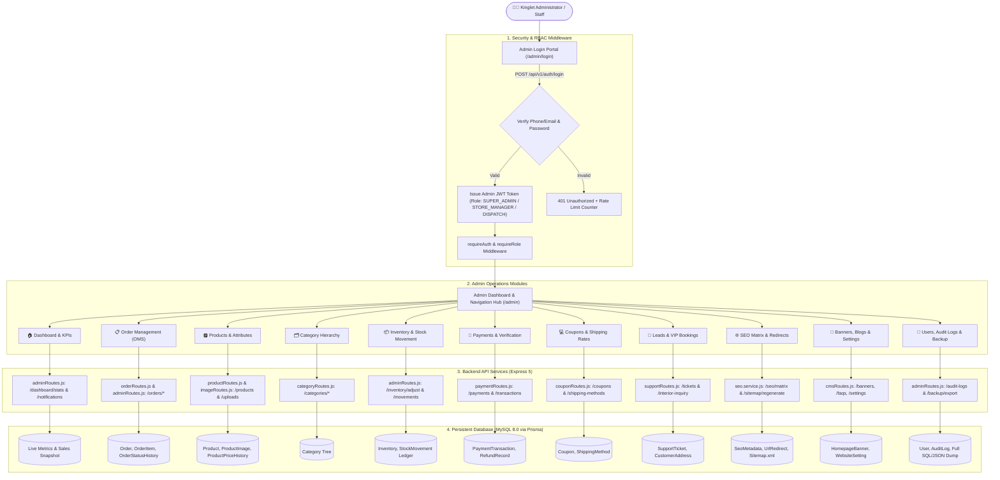
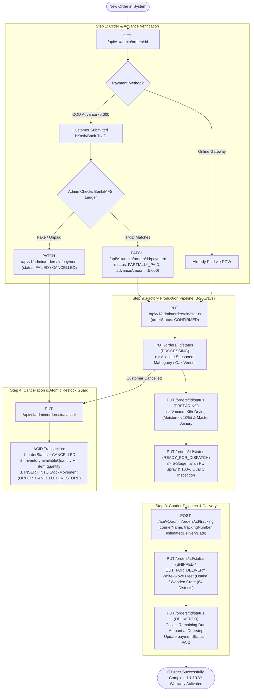
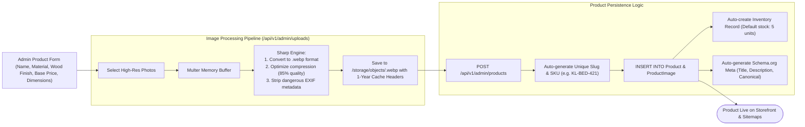
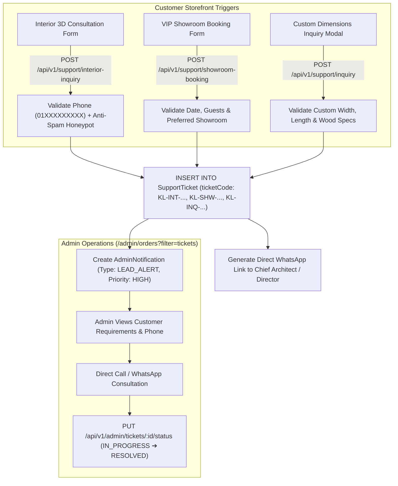

# Kinglet Bangladesh Ltd — Admin Portal (`kingletbd.com/admin`)
## Full Backend Architecture & Functionalities Flowchart

This document details the complete backend architecture, data processing pipelines, and module workflows powering the Kinglet Furniture & Interior Admin Operations Portal (`/admin`).

---

## ১. Master Backend Architecture Flowchart (`/admin`)

Full end-to-end map from Administrator Authentication through RBAC middleware, backend controllers, and MySQL 8.0 database persistence:

---

## ২. Order Management System (OMS) Backend Flowchart

Step-by-step lifecycle handling COD security advances, manual bKash/Bank TrxID verification, factory joinery progression, shipment, and atomic restock guard:

---

## ৩. Product Catalog & Multi-Image Pipeline Flowchart

Image Sharp processing, WebP compression, EXIF stripping, and persistent disk caching:

---

## ৪. Lead & Consultation Desk Flowchart (`/admin/orders?filter=tickets`)

Customer inquiries from 3D consultation, showroom VIP bookings, and custom sizing:

---

## ৫. Complete Admin Portal Backend Endpoints Reference Table

| অ্যাডমিন মেনু লিংক | ফ্রন্টএন্ড পাথ | ব্যাকএন্ড API এন্ডপয়েন্ট | HTTP মেথড | ব্যাকএন্ড ও ডেটাবেজ একশন |
| :--- | :--- | :--- | :---: | :--- |
| **Dashboard** | `/admin` | `/api/v1/admin/dashboard/stats` | `GET` | মোট সেলস, দৈনিক অর্ডার, লো স্টক অ্যালার্ট ও চার্ট ডেটা রিটার্ন করে। |
| **All Orders** | `/admin/orders` | `/api/v1/admin/orders` | `GET` | ফিল্টারসহ সব অর্ডারের তালিকা ও কাস্টমার স্ন্যাপশট লোড করে। |
| **Order Status** | `/admin/orders` | `/api/v1/admin/orders/:id/status` | `PUT` | অর্ডারের স্ট্যাটাস পরিবর্তন করে এবং `OrderStatusHistory`-তে লগ রাখে। |
| **Verify Payment** | `/admin/orders` | `/api/v1/admin/orders/:id/payment` | `PATCH` | bKash/Bank TrxID অ্যাপ্রুভ করে এবং ৳৫,০০০ সিওডি অ্যাডভান্স লেজারে যোগ করে। |
| **Dispatch Tracking**| `/admin/orders` | `/api/v1/admin/orders/:id/tracking` | `POST` | কুরিয়ার নাম, ট্র্যাকিং নম্বর ও আনুমানিক ডেলিভারির তারিখ সেভ করে। |
| **Cancel & Restock**| `/admin/orders` | `/api/v1/admin/orders/:id/cancel` | `POST` | অর্ডার বাতিল করে এবং ইনভেন্টরিতে কাঠের স্টক স্বয়ংক্রিয়ভাবে ফেরত দেয়। |
| **Manage Products** | `/admin/products`| `/api/v1/admin/products` | `GET`, `POST` | কাঠের ধরন, ফিনিশ, ওয়ারেন্টি ও সাইজ অনুযায়ী প্রোডাক্ট তৈরি ও সার্চ। |
| **Image Upload** | `/admin/products`| `/api/v1/admin/uploads` | `POST` | শার্প (Sharp) দিয়ে হাই-রেজ ছবিকে অপটিমাইজড `.webp`-তে কনভার্ট করে সেভ করে। |
| **Manage Inventory**| `/admin/inventory`| `/api/v1/admin/inventory/adjust` | `POST` | ম্যানুয়াল স্টক যোগ/বিয়োগ করে এবং `StockMovement` অডিট ট্রেইল সংরক্ষণ করে। |
| **Categories** | `/admin/categories`| `/api/v1/admin/categories` | `GET`, `POST` | ক্যাটাগরি ও সাব-ক্যাটাগরি ট্রি তৈরি ও স্লাগ ম্যানেজ করে। |
| **Coupons** | `/admin/coupons` | `/api/v1/admin/coupons` | `GET`, `POST` | ডিসকাউন্ট কুপন তৈরি, এক্সপায়ারি ও ব্যবহার সীমা নির্ধারণ করে। |
| **Lead Tickets** | `/admin/orders` | `/api/v1/admin/tickets` | `GET`, `PUT` | ইন্টেরিয়র ৩ডি ডিজাইন ও শোরুম ভিআইপি বুকিং স্ট্যাটাস ম্যানেজ করে। |
| **SEO Studio** | `/admin/seo` | `/api/v1/admin/seo/sitemap/regenerate` | `POST` | লাইভ ডাটাবেজ থেকে Google XML সাইটম্যাপ রিয়েল-টাইমে পুনরুৎপাদন করে। |
| **Audit Logs** | `/admin/orders` | `/api/v1/admin/audit-logs` | `GET` | কোন অ্যাডমিন কখন কোন অর্ডারে কি পরিবর্তন করেছেন তার অপরিবর্তনীয় প্রমাণ রাখে। |
| **Transactions** | `/admin/orders` | `/api/v1/admin/transactions` | `GET` | গেটওয়ে ও ম্যানুয়াল MFS লেনদেনের সম্পূর্ণ তালিকা রিটার্ন করে। |
| **Customers** | `/admin/orders` | `/api/v1/admin/customers` | `GET` | কাস্টমার প্রোফাইল, মোট অর্ডার সংখ্যা ও মোট খরচ লোড করে। |
| **Settings** | `/admin/content` | `/api/v1/admin/settings` | `GET`, `PUT` | সিওডি অ্যাডভান্স রুল, ডেলিভারি ফি ও হটলাইন কনফিগার করে। |

